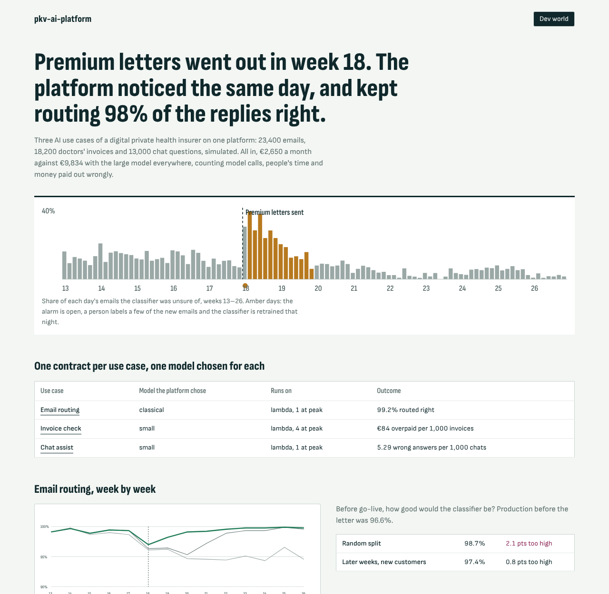

# pkv-ai-platform

[](https://github.com/manojrevenkar12-web/pkv-ai-platform/actions/workflows/ci.yml)

A digital private health insurer's AI team runs a handful of use cases (email routing, reading doctors' invoices,
helping chat agents) and wants them on **one platform** instead of three projects. This repository is that platform,
with those three use cases on it:

- **Every use case is a contract** (`config/usecases/*.toml`): what it reads and returns, which models may serve it,
  the bar it must clear, its traffic, and the data it touches. The platform refuses a contract it cannot check.
- **The model is chosen, not assumed.** Each candidate (a word-counting classifier, a small and a large Bedrock model)
  runs on the holdout weeks; the platform keeps the one with the lowest cost per case once people's time and money
  paid out wrongly are counted, among those that clear the gate.
- **Validation that predicts production.** A random split leaks a customer's follow-up emails into the test set;
  the platform splits by time and by customer.
- **Monitoring before labels arrive.** A daily test on the share of emails the classifier is unsure of catches a new
  kind of email the day it starts; people label a few of them, and the classifier is retrained that night.
- **The model reads, code decides.** Invoice settlement applies the fee schedule (GOÄ) in code; a chat draft reaches
  the agent only if it cites a clause it was given and states what that clause says.
- **Feasibility before building.** Each contract is checked for runtime (Lambda or Fargate), Bedrock quota at peak,
  and data rules; the result is a design note per use case and the Terraform inputs.



## Results on the dev world

23,400 emails, 18,200 invoices and 13,000 chat questions over 26 weeks, simulated;
weeks 1–10 train, 11–12 decide the gate, 13–26 are live. In week 18 the premium-adjustment letters go out.

**Per month, all three use cases, on the simulated volume:**

|  | Model cost | People hours | Overpaid on invoices | All in |
|---|--:|--:|--:|--:|
| Large model everywhere | €94.49 | 92.4 | €5,859 | €9,834 |
| **Platform** | €33.13 | 56.2 | €256 | **€2,650** |

People's time is costed at €42 an hour (`config/platform.toml`).

### Email routing

| Design | Accuracy | On answers to the letter | Misroutes a week | Sent to an LLM | Model cost a month | People hours a month |
|---|--:|--:|--:|--:|--:|--:|
| Large model routes every email | 94.9% | 93.4% | 45.6 | 100.0% | €9.26 | 19.7 |
| Small model routes every email | 92.0% | 87.8% | 72.4 | 100.0% | €3.00 | 31.4 |
| Classifier, never retrained | 96.6% | 87.8% | 31.0 | 32.5% | €1.05 | 13.4 |
| Classifier retrained weekly, no monitor | 98.5% | 95.3% | 13.6 | 15.7% | €0.55 | 5.9 |
| **Platform: retrained weekly, monitored, labels on alarm** | 99.2% | 98.2% | 7.2 | 9.5% | €0.38 | 4.4 |

The monitor raised its alarm 0 days after the letters went out (29% of emails under the confidence floor, against 12% usually),
with 0 false alarms in the weeks before. People labelled 253 emails in all.

| Accuracy by week | Week 17 | Week 18 | Week 19 | Week 20 | Week 21 |
|---|--:|--:|--:|--:|--:|
| Classifier, never retrained | 98.7% | 96.1% | 96.2% | 94.7% | 94.6% |
| Classifier retrained weekly, no monitor | 99.3% | 96.3% | 96.4% | 95.3% | 97.2% |
| Platform: retrained weekly, monitored, labels on alarm | 99.3% | 97.0% | 98.2% | 99.1% | 99.2% |

**Validation that predicts production** (the classifier alone, trained on weeks 1–10):

| Estimate | Accuracy | Off by |
|---|--:|--:|
| Random 20% split of weeks 1–12 | 98.7% | +2.1 pts |
| Weeks 11–12, customers not seen in training | 97.4% | +0.8 pts |
| Production, weeks 13–17 | 96.6% |  |

### Invoice check

| Design | Settled without a person | Overpaid per 1,000 invoices | Underpaid per 1,000 | Wrong automatic settlements | Model cost per invoice |
|---|--:|--:|--:|--:|--:|
| Large model reads and settles | 99.5% | €1,931 | €64 | 449 | €0.0207 |
| Small model reads, code settles | 99.4% | €89 | €1,117 | 921 | €0.0068 |
| **Platform: code settles, disputed lines read twice** | 98.6% | €84 | €43 | 61 | €0.0082 |

Example the platform settled (`R008404`): billed €107.61, paid €99.45, because GOÄ 410: factor 2.5 above the threshold without a written reason; GOÄ 410: billed 29.14, allowed 20.98.

### Chat assist

| Design | Drafts the agent sends as they are | Wrong answers to customers per 1,000 | Agent minutes per chat | Model cost per chat |
|---|--:|--:|--:|--:|
| Large model answers from memory | 35.4% | 256.43 | 2.56 | €0.0103 |
| Large model with retrieved clauses | 64.7% | 54.86 | 1.98 | €0.0103 |
| **Platform: rewrite, retrieve, check the draft** | 87.9% | 5.29 | 1.36 | €0.0036 |

Retrieval finds the right clause in the top 3 for 100% of questions asked in the tariff's own words and
29% of questions in the customer's own words; asking the model to restate the question first lifts that to
83%. The retrieval-score floor (0.125) is calibrated on the holdout weeks so the 90% upper bound of
the wrong-answer rate stays within the gate.

### Model chosen per use case

| Use case | Chosen | Candidate | Candidate | Candidate |
|---|--:|--:|--:|--:|
| Email routing | classical | classical: 99.4%, €0.026 all in | small: 93.5%, €0.274 all in | large: 95.8%, €0.180 all in (fails: cost 0.0024 over 0.002; p95 latency 4.5s over 3.0s) |
| Invoice check | small | small: 99.9%, €0.064 all in | large: 99.6%, €0.160 all in |  |
| Chat assist | small | small: 99.9%, €0.942 all in | large: 99.8%, €0.844 all in (fails: p95 latency 9.0s over 6.0s) |  |

### Where each use case runs

| Use case | Runtime | Lambda cheaper until (cases a day) | Concurrency at peak | Share of Bedrock quota at peak | Input through S3 |
|---|--:|--:|--:|--:|--:|
| Chat assist | lambda | 49,450 | 1 | 7.0% | no |
| Invoice check | lambda | 2,383 | 4 | 13.8% | yes |
| Email routing | lambda | 98,499 | 1 | 0.2% | no |

Design notes: [routing](docs/architecture/routing.md), [invoices](docs/architecture/invoices.md), [assist](docs/architecture/assist.md).

## Held-out world

Not run yet. `python scripts/evaluate.py --heldout` runs it once and writes `config/heldout.lock`.

## How it is built

| Part | Files | What it does |
|---|---|---|
| Contracts | `config/usecases/*.toml`, `src/pkvai/platform/contract.py` | One file per use case; validated before anything runs. |
| Model choice | `src/pkvai/platform/select.py` | Candidates on the holdout weeks; the gate, then the lowest cost all in. |
| Monitoring | `src/pkvai/platform/monitor.py` | Binomial test on the unsure share, PSI on the predicted mix, reviewed quality. |
| Feasibility | `src/pkvai/platform/feasibility.py`, `scripts/design.py` | Lambda or Fargate, quota at peak, data rules; writes the design notes and Terraform inputs. |
| Routing | `src/pkvai/usecases/routing.py` | Hashed n-grams, tf-idf, logistic regression; LLM for the unsure tail. |
| Invoices | `src/pkvai/usecases/invoices.py`, `config/fees.toml` | Arithmetic self-check, reasons above the threshold, fee agreements, excluded pairs. |
| Assist | `src/pkvai/usecases/assist.py` | Clause index, retrieval, grounding check. |
| Live calls | `src/pkvai/llm.py`, `prompts/` | Bedrock Converse with a forced tool for every call. |
| Infrastructure | `infra/modules/usecase`, `infra/live` | Per use case: SQS with a dead-letter queue, S3 with retention, KMS, a role limited to its models, Lambda or Fargate, alarms on dead letters and reviewed quality. |
| Evaluation | `scripts/evaluate.py`, `scripts/gate.py` | Designs on the same items and the same luck; the gate in CI. |
| Console | `web/` | React, Vite, React Query, Framer Motion. |

## Run it

```bash
pip install -e ".[dev]"
python -m pytest -q
python scripts/evaluate.py      # dev world -> reports/dev.json (about 40 s)
python scripts/gate.py
python scripts/design.py        # design notes and infra/live/usecases.auto.tfvars.json
python scripts/readme.py        # this README and the console data
cd infra/live && terraform init -backend=false && terraform validate
cd web && npm ci && npm run build
```

## Limits

- The insurer, its customers, invoices, chat questions and the models' mistakes are simulated (`config/world.toml`).
  The tariff in `src/pkvai/world/text.py` is fictional; the fee schedule in `config/fees.toml` is an illustrative
  excerpt in the shape of the GOÄ and has to be checked against the official schedule before any real use.
- The Bedrock client and prompts are written for the live calls and have not been run against Bedrock here; the
  Terraform is validated in CI, not applied. Prices in `config/platform.toml` are illustrative.
- The embedder is a small hashed n-gram model so the evaluation runs anywhere; in production the same interface wraps
  a Bedrock embedding model and pgvector.
